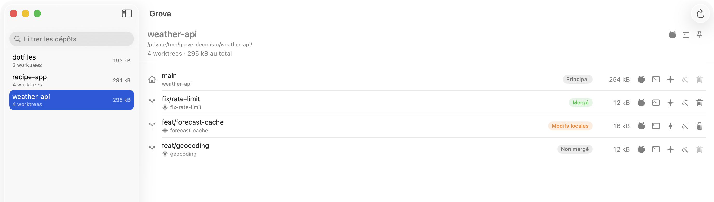
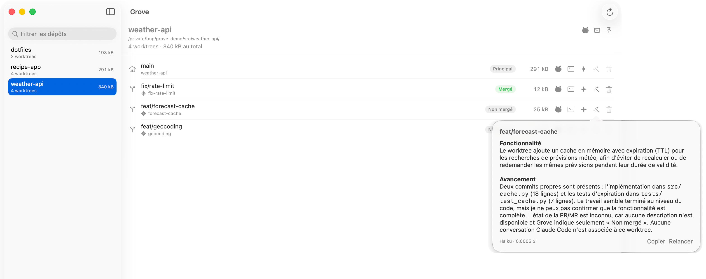
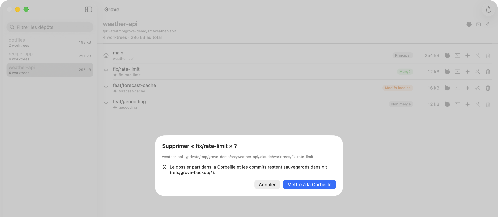

# 🌳 Grove

**Your git worktrees, finally under control.** Grove is a native macOS app that lists the worktrees of all your repositories, tells you which ones are safe to delete, and opens any of them in a terminal, Claude Code or its pull request in one click.

Coding agents love spawning worktrees. A few weeks later you have dozens of them, eating gigabytes, and no idea which ones still matter. Grove answers that.

## Features

- 🔭 **See everything at once**: point Grove at your project folders and get every worktree of every repo, with its status (merged, local changes, unmerged…) and its size on disk.
- 🧹 **Clean up without fear**: deletion goes through one safe path. A backup ref keeps every commit, files land in the Trash, and locked, unmerged or detached-only worktrees are refused. Nothing is ever lost.
- ⚡ **One click away**: open a worktree in your terminal, resume its Claude Code session, or jump straight to its GitHub pull request or GitLab merge request.
- 🤖 **Ask Claude what a worktree is about**: one click on *Explain* and Claude reads the git history, your Claude Code sessions and the PR/MR, then tells you what the worktree does, how far along it is and whether it can go. Haiku by default, capped at $0.25 per call.
- 📍 **Always at hand**: a menu bar view of your most active repos.

Requires macOS 26. The interface is in French.

---

Fully vibe coded. Be kind.
